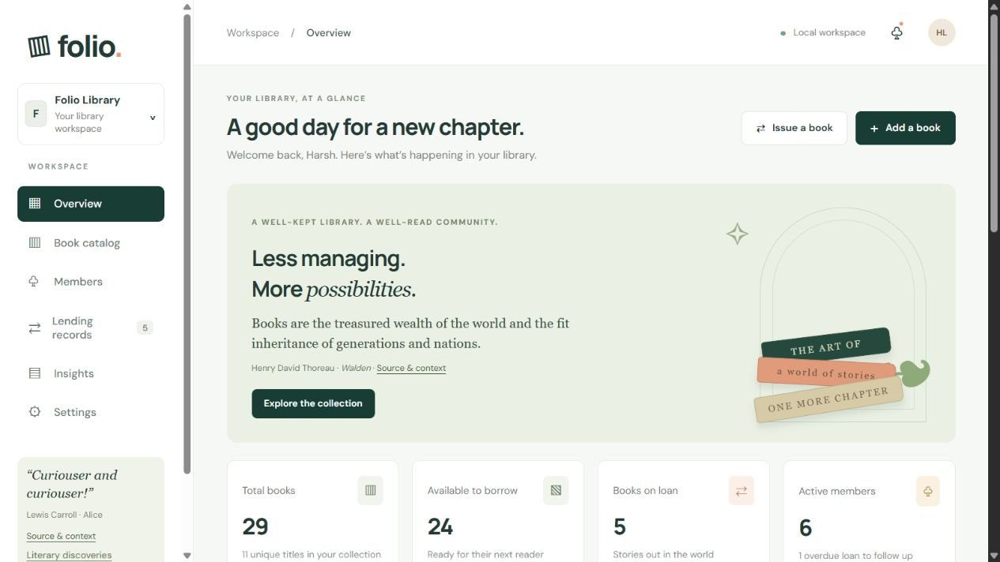

# Folio · Library, beautifully managed



**Vanilla JavaScript · C++17 · OOP · STL · File persistence · MIT**

A welcoming library management portfolio project. Browse books, manage readers, track lending, and discover human-written passages from classic literature.

A portfolio project pairing a carefully designed library web experience with a C++17 domain engine. Forest green, soft sage, warm book covers, and coral accents create a calm, welcoming workspace. Responsive layouts support desktop and mobile, with accessible forms, dialogs, keyboard focus, and clear empty states.

## Run the web interface

With Node.js 18 or newer, run:

```sh
git clone https://github.com/harshshodey/folio-library.git
cd folio-library
npm start
```

Then open [http://127.0.0.1:4173](http://127.0.0.1:4173). No install step is needed. Alternatively, serve `dist` using any static HTTP server. No build step or JavaScript dependencies are required. The interface uses DM Sans and Manrope from Google Fonts with system fallbacks. Cover art is created in CSS; no external images are required.

Features: dashboard, searchable and filterable catalog, book details, add books, add members, member search, issue books, confirm returns, overdue tracking, circulation insights, recent activity, JSON export/import, and a confirmed demo reset. The audited version adds book and member editing, loan renewal, loan search, catalog sorting, complete mobile navigation, original-data recovery, and cross-tab change detection. New records update availability and counts immediately. The demo includes sample books and fictional members; due dates are relative to the first launch.

**Storage boundary:** The web application uses browser localStorage. The C++ program is a separate terminal application with its own file format. They are not connected and do not share data or backup files. This is a working single-browser portfolio demo, not a production multi-user service. The web app provides a JSON backup format; the C++ engine writes `FOLIO 1` text records. Settings explains this boundary in the interface.

## Regression checks

Run `node --test tests/web.test.cjs` with Node.js 18 or newer. The dependency-free suite exercises the application with a small DOM/storage harness: lending transitions, invalid backups, failed saves, cross-tab conflicts, editing safeguards, renewal, sorting, and empty workspaces. Browser checks separately cover real forms, downloads, file import, navigation, and responsive layouts. See `QA.txt` for the audit record.

## Build the C++ engine

With GCC/MinGW:

```sh
g++ -std=c++17 -Wall -Wextra -Wpedantic cpp/main.cpp -o folio
./folio --self-test
./folio
```

On Windows, use `folio.exe` instead of `./folio`. Optionally pass a data file path: `folio.exe my-library.db`. The default file is `folio.db` in the working directory. With CMake, use `cmake -S . -B build`, `cmake --build build`, then `ctest --test-dir build --output-on-failure` (for a multi-configuration generator, add `-C Debug`).

Example terminal session:

```text
add-book "The Midnight Library" "Matt Haig" "Fiction" 3
add-member "Alex Reader" "alex@example.com"
issue 1 1 14
books midnight
loans
renew 1 14
return 1
quit
```

The engine is intentionally dependency free. It uses UTC epoch days for loan periods; the browser uses local calendar dates. Both use a default 14-day lending period.

## Architecture and concepts

| Concept | Implementation |
|---|---|
| Encapsulation | `Library` owns state and enforces lending rules through methods |
| Abstraction / polymorphism | `Repository` interface; `FileRepository` and test `MemoryRepository` implementations |
| Composition | A repository is injected into the library; entities remain simple value objects |
| STL | `vector`, `unordered_map`, `copy_if`, `sort`, `transform`, `count_if`, `find_if`, `any_of` |
| File handling | Versioned quoted text records; RAII streams; temporary writes; backup copy; checked file replacement |
| Error handling | Domain exceptions; malformed input rejection; corrupt-file detection; CLI recovery loop |
| Transaction behavior | Validate and save a candidate state before replacing in-memory data |

The file repository preserves a `.bak` copy before replacing an existing data file and attempts recovery after replacement failure. It is designed for a single running process. It does not provide database locking or power-loss atomicity on every platform. Never run multiple writers against the same file.

The self-test checks invalid records, duplicate emails, case-insensitive search, unavailable copies, nonexistent members, invalid periods, double returns, availability transitions, simulated save-failure rollback, file round trips, and corrupt input rejection.

## Portfolio talking points

Explain the difference between title inventory and physical copies, how active loans determine availability, why returns retain history, and how repository injection separates persistence from business rules. Show checkout and return in the web demo, then run the C++ self-test and terminal example. A logical next step is an authenticated API backed by a transactional database, connecting the existing interface to the domain service.

## Privacy and backups

Use fictional reader data when showcasing the project. Browser records belong to the browser profile and can be lost when site data is cleared. Export a backup from Settings before resetting the demo or switching devices. Import validates references and available copy counts before replacing records.

The C++ engine now validates loaded email uniqueness and duplicate active loans as well as runtime input. `renew loan-id [days]` extends an active loan from its due date or today, whichever is later, with a one-year maximum due-date horizon.

## Literary discoveries

The interface includes twelve verbatim passages from eight classic works by six authors. `dist/passages.js` contains the copied text and provenance. Source & context opens a separate dialog so checking a quotation does not discard a form. Read the original text opens the cited source in a new tab. Character speech and partial excerpts are identified in the context view; the context descriptions are editorial notes, not quotations. `SOURCES.txt` lists sources and verification notes.

Explore the margins of each section, choose Another passage, or browse the full literary collection. Book details and selected forms include smaller attributed excerpts. Destructive confirmations and error messages remain plain and direct. These additions do not claim that all interface labels or editorial notes were written by the quoted authors.

The catalog’s Find my next read button chooses a currently available title within the active search and filters. Clear filters restores the full catalog. Press `/` outside a form field to focus the current section’s search input. Availability counts and entity lookups are indexed once per saved state rather than repeatedly scanning all loans for every book card.

## License and credits

Original source code and documentation are available under the [MIT license](LICENSE). Literary excerpts retain their original attribution; see [SOURCES.txt](SOURCES.txt) and [THIRD_PARTY_NOTICES.txt](THIRD_PARTY_NOTICES.txt). Contributions are welcome; see [CONTRIBUTING.md](CONTRIBUTING.md).

The hosted portfolio preview is currently owner-private. Run the source locally to explore the full demo.
